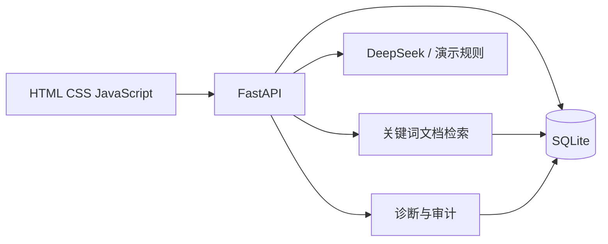

# IoTa Ops Copilot

面向 IoT 运维场景的 AI 助手。它把设备状态、活跃告警和运维手册片段放进同一诊断上下文，生成包含原因、证据和排查步骤的建议。

> 当前是可运行的本地 MVP：设备和告警使用模拟数据；SQLite 持久化告警、诊断、审计和知识库。服务端可调用 DeepSeek 等 OpenAI 兼容模型，未配置密钥时使用明确标记的本地演示诊断。项目不会控制真实设备。

## 功能

- 运维总览：在线率、告警、网关状态和设备趋势。
- 设备管理：状态筛选、设备/区域/网关搜索，并可从设备进入诊断。
- 告警中心：搜索告警、更新处置状态，并持久化审计记录。
- 知识库：导入 UTF-8 `.txt` / `.md`，文本切片后用本地关键词相关度检索。
- AI 诊断：读取设备、活跃告警和检索到的手册片段，返回结构化建议和来源。
- FastAPI API、SQLite 持久化，以及 GitHub Actions API 测试。

## 本地运行

需要 Python 3.10+。在仓库根目录创建并安装虚拟环境。

Windows PowerShell：

```powershell
python -m venv .venv
.\.venv\Scripts\python.exe -m pip install -r requirements.txt
.\.venv\Scripts\python.exe -m uvicorn server:app --host 127.0.0.1 --port 8000
```

macOS / Linux：

```bash
python3 -m venv .venv
.venv/bin/python -m pip install -r requirements.txt
.venv/bin/python -m uvicorn server:app --host 127.0.0.1 --port 8000
```

打开 `http://localhost:8000`。Swagger API 文档位于 `http://localhost:8000/docs`。首次启动会在 `data/iota_ops.db` 创建 SQLite 数据库并写入示例设备、告警和运维手册。可用 `IOTA_DB_PATH` 和 `IOTA_UPLOAD_DIR` 指定数据目录。

## DeepSeek 配置

在同一个启动服务的终端设置环境变量。不要把 API Key 提交到仓库。

```powershell
$secureKey = Read-Host "DeepSeek API Key" -AsSecureString
$env:MODEL_API_KEY = [System.Net.NetworkCredential]::new("", $secureKey).Password
$env:MODEL_BASE_URL = "https://api.deepseek.com/v1"
$env:MODEL_NAME = "deepseek-flash"
.\.venv\Scripts\python.exe -m uvicorn server:app --host 127.0.0.1 --port 8000
```

可在 DeepSeek 开放平台创建 API Key。模型名称以账号当前可用列表为准，例如 `deepseek-flash` 或 `deepseek-v4-pro`。顶部显示“真实模型”表示 API Key 已读入；实际诊断请求成功后才算模型调用通过。使用其他 OpenAI 兼容服务时修改 `MODEL_BASE_URL` 和 `MODEL_NAME`。

模型请求包含本地设备/告警上下文和命中的知识库片段。导入文档前，确认其中的信息可以发送到你配置的模型服务。

## 测试

Windows PowerShell：

```powershell
.\.venv\Scripts\python.exe -m pip install -r requirements-dev.txt
.\.venv\Scripts\python.exe -m unittest discover -s tests -v
```

macOS / Linux：

```bash
.venv/bin/python -m pip install -r requirements-dev.txt
.venv/bin/python -m unittest discover -s tests -v
```

测试覆盖种子数据、告警持久化与审计、文本手册上传/检索，以及错误文件类型拒绝。GitHub Actions 会在 push 和 pull request 时运行同一套测试。

## 架构与边界



当前遥测和告警为可复现的模拟数据，中文知识检索使用关键词相关度排序，尚未接入 MQTT、向量检索、用户认证或真实设备控制。设备控制等有副作用的操作不开放。

## 面试演示

1. 打开总览，查看设备、告警和趋势。
2. 在 AI 助手中询问“分析 GW-204 网关关联设备离线原因”。
3. 检查回答中的事实、推断、排查步骤和运维手册来源。
4. 在运维知识库导入 [`examples/runbooks/冷链温度异常处置.md`](examples/runbooks/冷链温度异常处置.md)，询问冷链温度异常的排查方法并观察引用。
5. 更新告警状态后刷新页面，确认状态和审计记录仍保留。

## 上传到 GitHub

先在 GitHub 创建一个空仓库，然后在项目根目录执行：

```bash
git add .
git status
git commit -m "Initial IoTa Ops Copilot MVP"
git remote add origin https://github.com/<your-account>/<your-repository>.git
git push -u origin main
```

确认 `git status` 没有 `.env`、`.venv/` 或 `data/` 下的本地数据库和上传文档。公开仓库前，请自行选择并添加适合的开源许可证。
